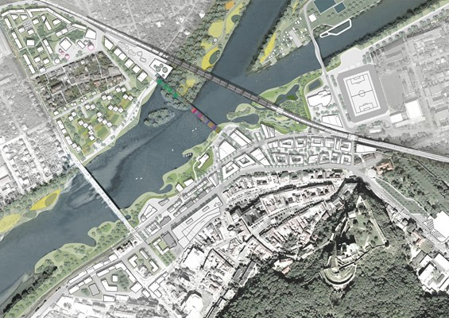
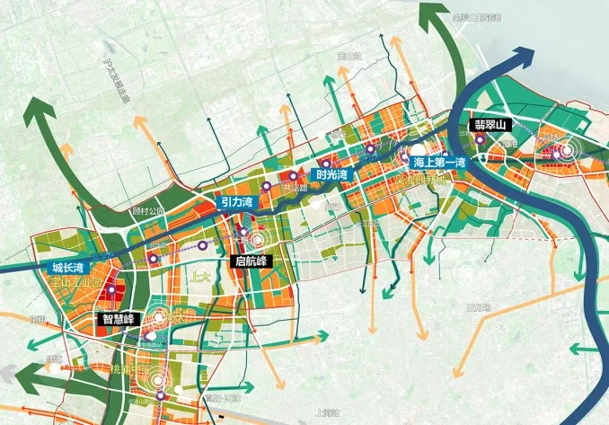
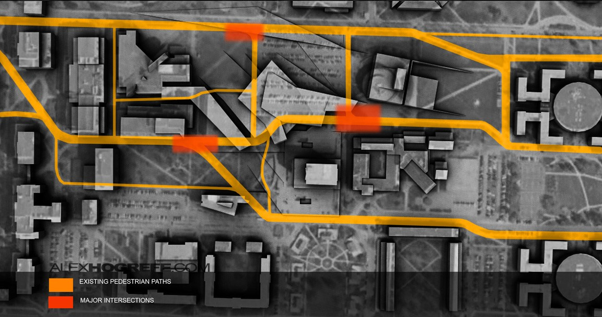
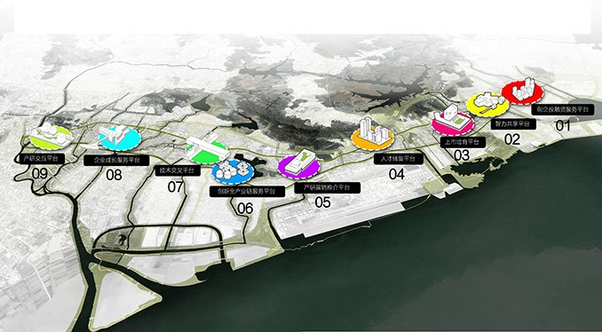
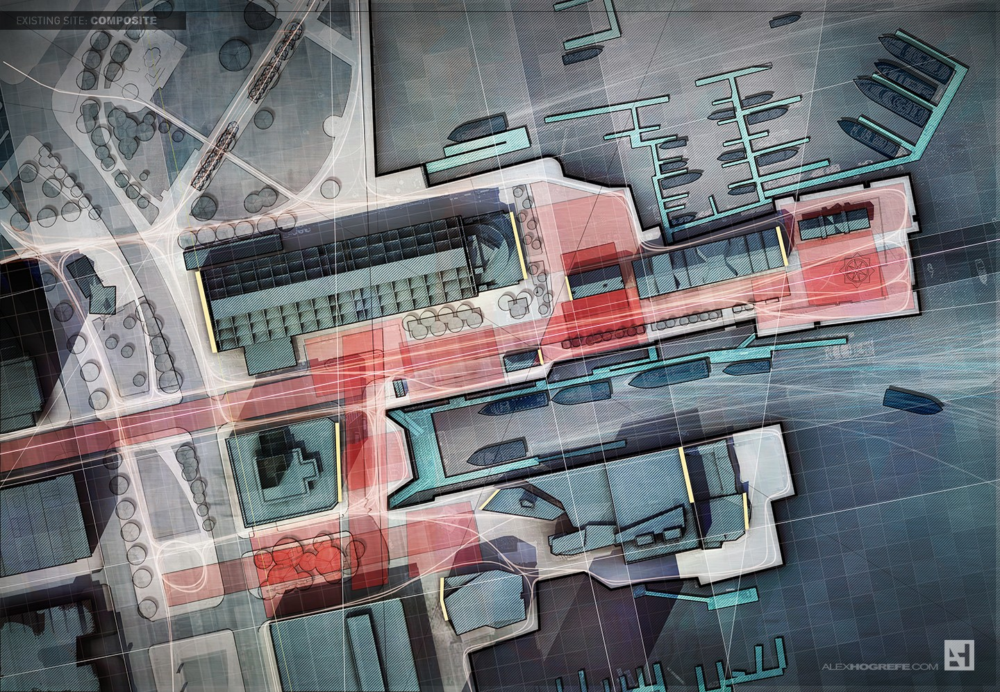
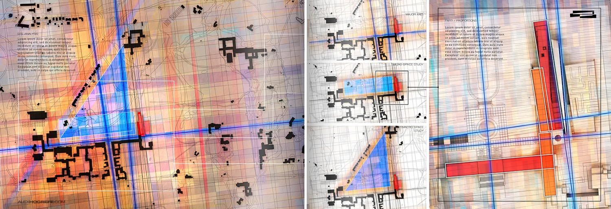

# 区位分析案例评审｜阶段1

本包仅供风格选择，未制作上海最终区位图。核对日期：2026-10-29。7个案例：2个城市设计竞赛获奖项目、1个专业奖项框架、4个专业作品集／教学图解。后者用于表达借鉴，不冒称竞赛获奖作品。

应用对象为已核验约66.0948 ha核心设计边界；22.009 km²研究区仅作背景，不能替代红线。案例内方案、节点与箭头不是本项目事实。

## 检索与筛选

检索 WLA 的 urban design competition、Visualizing Architecture 的 site analysis / diagrams 等专题，核对文章与真实图片并检查图面。ASLA旧档案入口失效、ArchDaily动态结果未形成可核验案例，未计入。前海候选以模型为主，Chouteau与Derbent候选以效果图为主，未入选。保留能表达城市结构、区域联系、路径或多尺度展板组织的图面。

部分图是规划方案图，并非现状区位图；逐例指出迁移边界。预览保留完整画幅，版权归原作者。公开访问不等于开放授权；缩略图仅用于本次评论与选择，不作为本项目成图素材，不据此分发商业素材包。最终制图使用本项目真实GIS与自行绘制符号。

## 01｜Trenčín 城市与滨水结构（A）

Mandaworks + Hosper｜2014 国际城市设计竞赛一等奖

- 发布页：https://worldlandscapearchitect.com/mandaworks-hosper-win-international-urban-design-competition-in-trencin-slovakia/
- 原图：https://worldlandscapearchitect.com/wp-content/uploads/2014/05/Trencin-Masterplan-Low-Res.jpg
- **风格特点**：浅底低饱和总平，弱化城市肌理。
- **构图方式**：一张大总平统领，河流成为构图骨架。
- **色彩倾向**：灰白建筑、蓝灰水面、黄绿空间。
- **信息层级**：河流和城市连接优先，建筑肌理其次。
- **是否适合本项目**：适合片区层级；宏观上海定位需另配小图。
- **可借鉴点**：借鉴背景降权、道路跨越及开放空间连续性。
- **不建议照搬**：这是方案总平，不可将新增桥梁、绿地当成现状；不复制滨河条件。

## 02｜Shanghai Midtown Belt 北部框架（A）

MLA+ Consortium｜2026 WLA Outstanding Award，概念总体规划与城市设计

- 发布页：https://worldlandscapearchitect.com/shanghai-midtown-belt-a-landscape-led-urban-design-framework/
- 原图：https://worldlandscapearchitect.com/wp-content/uploads/2026/09/262139-North-UDF-Diagram-By-MLA_-Consortium-678x473.webp
- **风格特点**：浅底结构图，走廊、节点与板块清晰。
- **构图方式**：城市带展开，箭头表达跨区域联系，节点分级。
- **色彩倾向**：浅灰底、绿蓝骨架、橙色功能块。
- **信息层级**：区域通道—片区节点—功能板块。
- **是否适合本项目**：很适合上海片区关系；原项目约600 km²，与66.10 ha场地尺度不同。
- **可借鉴点**：借鉴城市资源与走廊关系；本项目边界独立用朱红线。
- **不建议照搬**：图中包含规划意图，不能复制为现状；箭头不是流量或真实车行时间。

## 03｜Thesis 步行联系图（B）

Alex Hogrefe｜2011 学位项目图解，非竞赛获奖案例

- 发布页：https://visualizingarchitecture.com/thesis-diagrams/
- 原图：https://visualizingarchitecture.com/wp-content/uploads/2011/12/paths_diagram_architecture_alex_hogrefe_1.jpg
- **风格特点**：黑白体块配高亮路径，焦点集中。
- **构图方式**：俯视场地，路径横贯画面，角部图例。
- **色彩倾向**：炭黑、灰白、橙黄。
- **信息层级**：路径最强，体块其次，背景退后。
- **是否适合本项目**：适合局部交通插图；不足以独立承担上海宏观区位。
- **可借鉴点**：借鉴路径分级与底图上的简洁图例。
- **不建议照搬**：线宽不代表实测人流；不能照搬其路线或把估计高度当成测绘。

## 04｜Philly Bridge 场地联系图（B）

Alex Hogrefe｜2017 专业作品集／教程，非竞赛

- 发布页：https://visualizingarchitecture.com/philly-diagram-study/
- 原图：https://visualizingarchitecture.com/wp-content/uploads/2017/06/Phil_Diagram_16_Final_Cropped.jpg
- **风格特点**：深色模型上用暖色强化交通和地面空间。
- **构图方式**：斜俯视，以斜向交通结构带出场地焦点。
- **色彩倾向**：深紫灰、橙红、暖黄。
- **信息层级**：交通结构—场地空间—背景建筑。
- **是否适合本项目**：局部识别性强，宏观定位能力较弱。
- **可借鉴点**：借鉴单一主题高对比和背景降权。
- **不建议照搬**：不借鉴景深模糊、雾化和夸张光效，以免影响真实边界、道路辨识。

## 05｜Bao’an G107 城市更新走廊（C）

MLA+、Felixx、CAUPD及深圳市政设计研究院｜2016 城市设计竞赛一等奖

- 发布页：https://worldlandscapearchitect.com/mla-felixx-wins-the-baoan-urban-design-competition-in-shenzhen-china/
- 原图：https://worldlandscapearchitect.com/wp-content/uploads/2016/08/03-Overview.jpg
- **风格特点**：浅底城市拼贴，编号节点串联区域叙事。
- **构图方式**：斜俯视长走廊配节点编号和城市背景。
- **色彩倾向**：灰白底、黑色标题牌、彩色节点。
- **信息层级**：更新走廊—编号节点—背景城市。
- **是否适合本项目**：适合解释地块与周边板块协同；须限制标签数量。
- **可借鉴点**：借鉴节点编号、短注释和跨尺度资源串联。
- **不建议照搬**：节点属于设计方案，不能复制为本项目现状设施；不移植新建体量。

## 06｜Long Wharf / Boston 多专题分析（C）

Alex Hogrefe｜2014 专业作品集／教程，非竞赛

- 发布页：https://visualizingarchitecture.com/site-analysis-diagrams/
- 原图：https://visualizingarchitecture.com/wp-content/uploads/2014/03/Wharf_diagrams_composite_all.jpg
- **风格特点**：柔和纹理底叠加路径、绿地和空间层。
- **构图方式**：连续背景叠加专题线面，以留白缓冲。
- **色彩倾向**：灰色纹理、青色水面与红色场地层。
- **信息层级**：整体肌理—专题联系—场地位置。
- **是否适合本项目**：适合资源综合；可用可靠矢量替代许可不明的影像纹理。
- **可借鉴点**：借鉴统一底图、可拆分专题、逐层显现信息。
- **不建议照搬**：港口船行逻辑不适用；不移植版权影像，不用低清底图制造高清假象。

## 07｜Cranbrook 多尺度图解展板（C）

Alex Hogrefe｜2013 校园建筑项目作品集，非竞赛

- 发布页：https://visualizingarchitecture.com/cranbrook-project-site-analysis-diagrams/
- 原图：https://visualizingarchitecture.com/wp-content/uploads/2014/05/Gallery_cranbrook_portfolio_spread_diagrams.jpg
- **风格特点**：浅底拼贴，整体结构、分层图解和局部放大共同叙事。
- **构图方式**：横向跨页，从校园整体进入局部场地。
- **色彩倾向**：暖灰底、冷色线层、少量强调色。
- **信息层级**：总览—专题分解—局部定位。
- **是否适合本项目**：很适合上海—城区—真实设计地块三级组织；校园事实不能迁移。
- **可借鉴点**：借鉴大小图阅读顺序、留白和短注释。
- **不建议照搬**：不把校园轴线当上海结构；不复制跨页缝、过小文字和装饰肌理。

